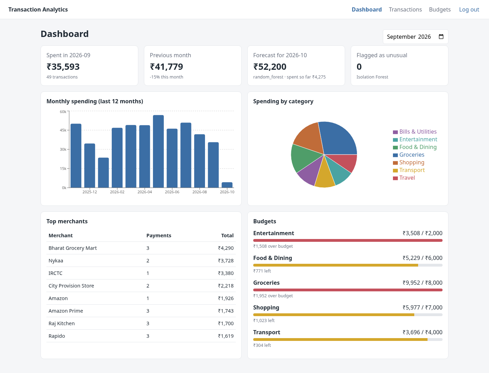
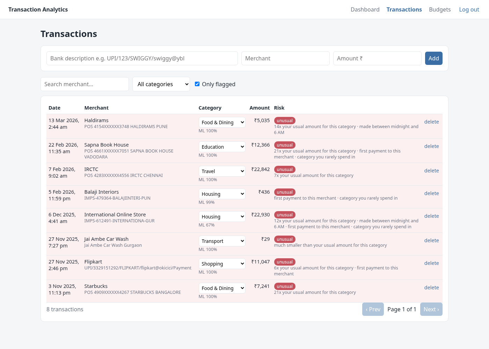

# AI Transaction Analytics Platform

A personal-finance dashboard with a separate machine-learning microservice that categorises expenses, flags unusual (potentially fraudulent) transactions and forecasts next month's spending.

| | |
|---|---|
| **ML microservice** | FastAPI, scikit-learn, XGBoost |
| **Models** | TF-IDF + Logistic Regression (categoriser), Isolation Forest (anomalies), Random Forest vs XGBoost (forecast) |
| **Backend** | Node.js, Express, MongoDB (Mongoose), JWT authentication, bcrypt |
| **Frontend** | React, TypeScript, Vite, Recharts |
| **Run** | `docker compose up --build` |



---

## 1. Architecture

```
 Browser (React + TS)
        │  /api/...  (JWT in the Authorization header)
        ▼
 Express REST API  ──────────────►  MongoDB
 (auth, transactions,               users, transactions, budgets
  budgets, analytics)
        │  HTTP / JSON
        ▼
 FastAPI ML microservice
   POST /categorize   text  -> category
   POST /anomaly      a user's transactions -> anomaly score per transaction
   POST /forecast     past monthly totals   -> next month's spend
```

The models run as a separate service because the Python models and the Node.js web app have different dependencies, scale differently and are retrained on a different schedule. The models can be retrained and redeployed without touching the web app, and if the ML service is down, the web app keeps working with fallbacks.

When a transaction is added:
1. Express receives `{ description, merchant, amount }`.
2. If no category is given, it calls `POST /categorize`, which returns the category and its confidence.
3. The transaction is saved in MongoDB.
4. Express sends the user's last 1,000 transactions to `POST /anomaly`, and every transaction gets a fresh anomaly score with human-readable reasons ("12x your usual amount for this category", "made between midnight and 6 AM").
5. The dashboard reads aggregated analytics (MongoDB aggregation pipelines) and the forecast (`POST /forecast`).

---

## 2. Data

Real bank statements cannot be shared, so the models are trained on a synthetic dataset generated by `ml-service/training/generate_data.py`, designed to look like Indian bank/UPI statements:

- 60 users × 24 months (2024–2025), 81,254 transactions, 10 categories
- messy bank-style descriptions: `UPI/412233/SWIGGY/swiggy@icici/Payment`, `POS 4521XXXXXX1234 UBER MUMBAI`, `IMPS-262497-JIORECHARGE-PUN`
- brand merchants (Swiggy, Zepto, Uber, …), local shops with random names (`Shree Ganesh Kirana`, `Sai Medical`), person-to-person UPI payments (ambiguous by design), recurring bills (rent, phone, subscriptions)
- seasonality (Diwali shopping in Oct/Nov, December travel, summer electricity) and slow spending growth
- about 1% injected anomalies: very large amounts, payments at 1–4 AM, unknown merchants such as "Gift Card Exchange"

The anomaly labels are used only to evaluate the Isolation Forest, which is trained without them.

---

## 3. Models and results

### 3.1 Expense categoriser: TF-IDF + Logistic Regression

Text is cleaned (lower-case, digits and symbols removed), then turned into TF-IDF features from word n-grams (1–2 words) and character n-grams (2–5 letters). Character n-grams let the model recognise `kirana` inside `SHREEGANESHKIRANA`, where there are no spaces. A class-balanced logistic regression outputs a probability per category.

| Test | Accuracy | Macro-F1 |
|---|---:|---:|
| Random 80/20 split | **95.6%** | 0.930 |
| Merchants never seen in training: local shops | **95.7%** | – |
| Merchants never seen in training: brand names | 20.3% | – |

The second test is grouped by merchant, so the model has never seen any test merchant (no leakage between train and test). It generalises well to unseen local shops, whose names contain category words ("Medical", "Kirana", "Fuels"). An unseen brand name such as "Nykaa" carries no category signal in the text alone, which is why users can correct a category in the UI.

### 3.2 Anomaly detector: Isolation Forest

Isolation Forest builds random trees that repeatedly split the data. Unusual points get isolated after only a few splits, so a short average path length means "anomalous". Every feature compares a payment with the same user's own history, because ₹20,000 is normal for one user and very unusual for another:

`log(amount)`, `amount ÷ user's median`, `amount ÷ user's median in this category`, hour of day (sin/cos), night-time flag, the user's share of payments in this category, and how often the user has paid this merchant before.



Evaluated on 12 held-out users (17,062 transactions) that the model never saw:

| ROC-AUC | Precision | Recall | F1 | Flag rate |
|---:|---:|---:|---:|---:|
| **0.990** | 0.727 | 0.753 | 0.740 | 1.0% |

An early version had a timezone bug. MongoDB stores dates in UTC, so a 9 AM payment in India reached the model as 03:30 and was flagged as a night-time payment (5.7% of the demo account was flagged). The API now sends local time to the model, and the flag rate dropped to 1.4%, matching the injected anomalies.

### 3.3 Monthly spending forecast: Random Forest vs XGBoost

For each user and month, features are built from previous months: spend 1, 2 and 3 months ago, the 6-month average, the 3-month volatility, the same month last year, month of year and a festive-season flag. All amounts are divided by the user's recent 3-month average, so a single model predicts a ratio ("10% above usual") that works for every spending level.

The split is by time: training uses months up to June 2025 and testing uses July–December 2025, because a random split would leak future months into training.

| Model | MAE | MAPE |
|---|---:|---:|
| Baseline: same as last month | ₹18,660 | 27.9% |
| Baseline: 3-month average | ₹14,816 | 22.0% |
| XGBoost | ₹14,645 | 21.6% |
| **Random Forest (served)** | **₹14,393** | **21.5%** |

Personal spending is noisy (about ±25% month to month), so the gain over a 3-month average is modest (3% lower MAE); the gain over the naive "same as last month" forecast is 23%. Both tree models are kept shallow and strongly regularised to avoid fitting the noise.

---

## 4. Running it

### With Docker (everything)

```bash
docker compose up --build
docker compose exec server npm run seed      # demo account with 12 months of data
```

Open http://localhost:3000 and log in with `demo@example.com` / `demo1234`. The ML API docs are at http://localhost:8000/docs.

### Without Docker (development)

```bash
# 1. MongoDB
docker run -d -p 27017:27017 mongo:7

# 2. ML service
cd ml-service
python -m venv .venv && source .venv/bin/activate
pip install -r requirements.txt -r requirements-dev.txt
python -m training.generate_data         # optional: models are already in models/
python -m training.train_categorizer
python -m training.train_anomaly
python -m training.train_forecaster
pytest -q
uvicorn app.main:app --port 8000

# 3. API
cd server && cp .env.example .env && npm install
npm run seed && npm run dev              # http://localhost:5000

# 4. Dashboard
cd client && npm install && npm run dev  # http://localhost:5173
```

---

## 5. API reference

All routes except `/api/auth/*` and `/api/health` need `Authorization: Bearer <token>`.

| Method | Route | Purpose |
|---|---|---|
| POST | `/api/auth/register` | create an account (password hashed with bcrypt), returns a JWT |
| POST | `/api/auth/login` | returns a JWT |
| GET | `/api/auth/me` | current user |
| GET | `/api/transactions?month=&category=&anomaly=&search=&page=` | list with filters and pagination |
| POST | `/api/transactions` | add one; categorised and anomaly-scored by the ML service |
| PATCH | `/api/transactions/:id` | correct the category |
| DELETE | `/api/transactions/:id` | delete |
| POST | `/api/transactions/rescan` | re-run anomaly detection |
| GET / PUT / DELETE | `/api/budgets` | monthly limit per category, with amount spent |
| GET | `/api/analytics/summary?month=` | totals, by category, top merchants, anomaly count |
| GET | `/api/analytics/monthly` | spend per month (last 12) |
| GET | `/api/analytics/forecast` | ML forecast for the current month |

---

## 6. Project structure

```
ml-service/
  app/main.py              FastAPI app: /categorize /anomaly /forecast /health /metrics
  app/features.py          feature engineering shared by training and serving
  app/schemas.py           request / response validation (Pydantic)
  training/generate_data.py
  training/train_categorizer.py
  training/train_anomaly.py
  training/train_forecaster.py
  models/                  trained models (.joblib) + metrics (.json)
  tests/test_api.py
server/
  src/routes/              auth, transactions, budgets, analytics
  src/models/              Mongoose schemas: User, Transaction, Budget
  src/middleware/auth.js   JWT check
  src/services/mlClient.js calls to the ML service (with fallbacks)
  scripts/seed.js          demo account
client/
  src/pages/               Login, Dashboard, Transactions, Budgets
  src/api.ts               fetch wrapper that adds the JWT
docker-compose.yml
```

## 7. Limitations

- Trained on synthetic data; real bank data would need retraining and probably more categories.
- Anomaly scores are relative to the user's own history, so a brand-new user with few transactions gets less reliable scores.
- Category corrections made by users are stored (`categorySource: "user"`) but not yet fed back into retraining.
